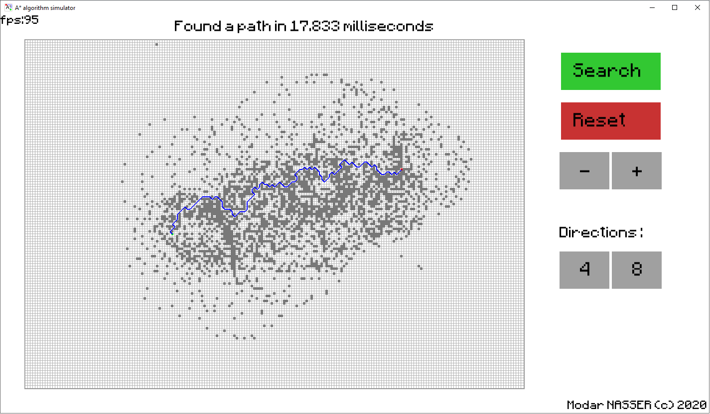
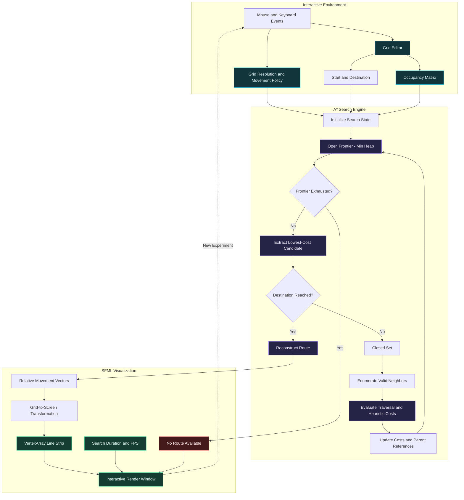
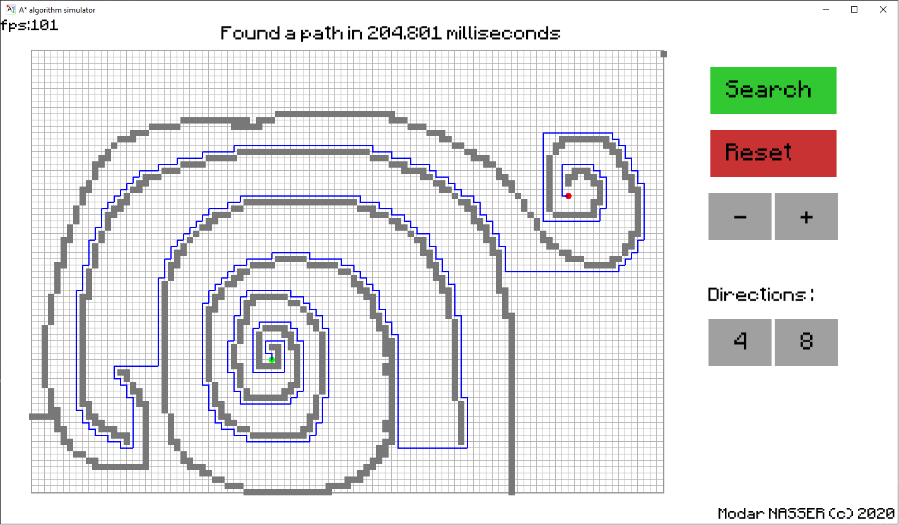
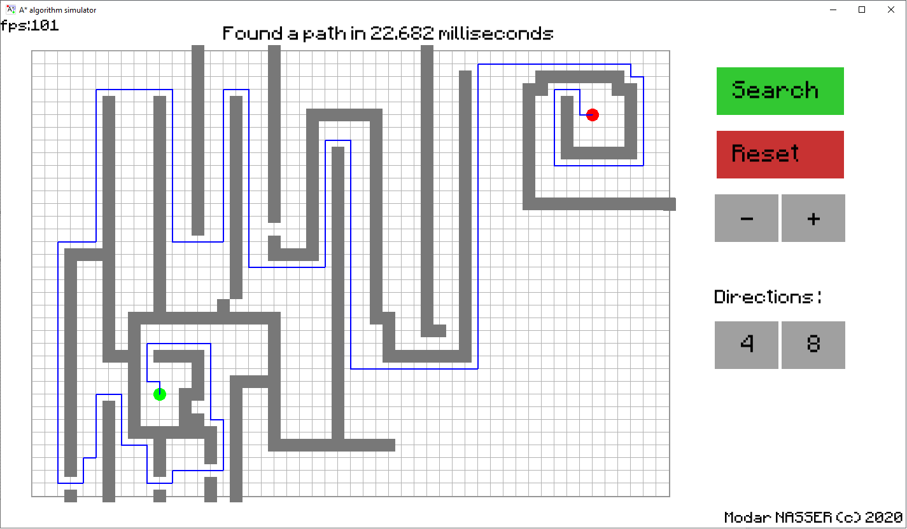

<div align="center">

  

  <h1>A* Simulator</h1>

  <p>
    <strong>Exploring the geometry of intelligent search.</strong>
  </p>

  <p>
    An interactive desktop application for exploring A* pathfinding,
    heuristic search, maze construction, and spatial navigation
    through Python and SFML.
  </p>

  [](https://www.python.org/)
  [](https://www.sfml-dev.org/)
  [](#pathfinding-engine)
  [](#getting-started)

  <p>
    <a href="#overview">Overview</a> ·
    <a href="#features">Features</a> ·
    <a href="#pathfinding-engine">Pathfinding</a> ·
    <a href="#architecture">Architecture</a> ·
    <a href="#gallery">Gallery</a>
  </p>

  

  <sub>Interactive exploration of heuristic search across complex spatial environments.</sub>

</div>

## Overview

A* Simulator is a desktop visualization tool designed to explore
heuristic search algorithms within customizable two-dimensional
environments.

The application allows users to construct their own mazes, define
starting and destination points, configure movement constraints,
and observe the routes generated by the A* algorithm.

By combining graph search with interactive computer graphics,
the simulator provides a practical environment for investigating
how spatial complexity, obstacle distribution, and movement
policies influence pathfinding behavior.

Built with Python and SFML, the project connects algorithmic
computation with event-driven desktop interfaces and real-time
graphical rendering.

## Features

| Feature | Description |
| :--- | :--- |
| **A* Pathfinding** | Heuristic-based route computation using a priority queue. |
| **Interactive Maze Editor** | Construct and modify spatial environments using mouse input. |
| **Configurable Grid** | Four grid resolutions for different levels of spatial complexity. |
| **Movement Policies** | Switch between four-directional and eight-directional search. |
| **Custom Endpoints** | Define arbitrary starting and destination positions. |
| **Path Visualization** | Render computed routes directly over the environment. |
| **Execution Timing** | Display search duration in milliseconds. |
| **FPS Monitoring** | Observe graphical rendering performance. |
| **Environment Reset** | Clear the current configuration and begin a new experiment. |
| **Unreachable Targets** | Report when no route can be found. |

## Pathfinding Engine

The simulator implements A*, a heuristic search algorithm
that evaluates candidate nodes by combining accumulated
traversal cost with an estimate of the remaining distance
to the destination.

### Evaluation function

$$
f(n) = g(n) + h(n)
$$

Where:

- $g(n)$ represents the accumulated cost from the starting node.
- $h(n)$ represents the heuristic estimate toward the destination.
- $f(n)$ determines the evaluation priority of the candidate node.

The implementation uses the squared Euclidean distance:

$$
h(n) = (x_g - x_n)^2 + (y_g - y_n)^2
$$

The same distance function is used to calculate movement costs,
resulting in a cost of one for orthogonal transitions and two
for diagonal transitions.

### Movement policies

The simulator supports two different neighborhood configurations.

| Four-Directional Search | Eight-Directional Search |
| :---: | :---: |
| Orthogonal movement | Orthogonal and diagonal movement |
| Up, down, left, right | Eight neighboring positions |

```text
    Four Directions          Eight Directions

          ↑                      ↖  ↑  ↗
          │                       \ │ /
      ← [ N ] →                ← [ N ] →
          │                       / │ \
          ↓                      ↙  ↓  ↘
```

Switching between these configurations changes the connectivity
of the underlying graph and the available routes through
the environment.

### Implementation details

| Component | Implementation |
| :--- | :--- |
| Open Frontier | Python `heapq` min-heap |
| Closed Set | Python `set` |
| Accumulated Costs | Dictionary-based `gscore` |
| Evaluation Costs | Dictionary-based `fscore` |
| Parent References | Dictionary-based `came_from` |
| Heuristic | Squared Euclidean distance |
| Reconstruction | Backtracking through parent references |
| Output | Sequence of relative movement vectors |
| Obstacle Detection | Grid occupancy and boundary validation |

> [!NOTE]
> The current squared-distance heuristic can overestimate the
> remaining traversal cost. Consequently, this implementation
> does not guarantee globally optimal paths in every environment.
> Diagonal movement also does not explicitly prevent corner-cutting.
>
> These characteristics make the simulator an interesting starting
> point for experimenting with alternative heuristics and movement
> constraints.

## Architecture

The application separates algorithm execution from graphical
interaction through two principal modules:

- `Astar.py` — search, heuristic evaluation, and path reconstruction.
- `Simulation.py` — environment management, event handling, and rendering.

The following diagram illustrates how user-defined environments
are transformed into computed and visualized routes.



This separation allows the pathfinding implementation to operate
independently of the graphical interface.

The search engine returns relative movement vectors, which the
simulation converts into screen coordinates for rendering.

## Simulation Environment

### Grid configuration

The application uses a fixed graphical workspace of 1000 × 700
pixels, with four configurable cell sizes.

| Preset | Cell Size | Nominal Grid | Visible Cells |
| :--- | ---: | ---: | ---: |
| Small | 50 px | 20 × 14 | 280 |
| Medium | 20 px | 50 × 35 | 1,750 |
| Large | 10 px | 100 × 70 | 7,000 |
| Extra Large | 5 px | 200 × 140 | 28,000 |

The internal occupancy matrix includes an additional boundary
row and column.

Higher grid resolutions allow more detailed maze construction
and increase the potential search space.

Changing the grid resolution resets the current environment.

### Visual conventions

| Color | Element |
| :--- | :--- |
| 🔴 Red | Starting point |
| 🟢 Green | Destination |
| ⬜ White | Traversable space |
| ◼️ Gray | Obstacle |
| 🟦 Blue | Computed route |

### Interaction workflow

1. Place the starting point.
2. Define the destination.
3. Draw walls to construct the environment.
4. Select four-directional or eight-directional movement.
5. Execute the search.
6. Inspect the computed route and execution time.

The environment can be modified and evaluated repeatedly,
making it possible to explore different spatial configurations.

## Graphics and Rendering

The visualization layer uses SFML through its Python bindings.

The graphical implementation includes:

- Event-driven mouse and keyboard interaction.
- Vertex arrays for grid and path rendering.
- Shape-based obstacle and endpoint representation.
- Custom graphical controls.
- Frame timing and FPS monitoring.
- Continuous window rendering.

The computed route is represented as a line strip using
`sf.VertexArray`, connecting successive spatial positions
within the environment.

The search duration is measured independently from graphical
rendering, allowing users to distinguish algorithm execution
time from the application's frame rate.

The simulator displays the resulting route after search
completion rather than animating the exploration frontier.

## Controls

| Input | Action |
| :--- | :--- |
| Left Click | Place starting point or destination. |
| Left Click + Drag | Draw obstacles. |
| Right Click + Drag | Remove obstacles. |
| Right Click | Return to the previous placement stage when applicable. |
| `Enter` | Execute pathfinding. |
| `+` | Increase cell size. |
| `-` | Decrease cell size. |
| `Esc` | Close the application. |
| Search Button | Compute a route. |
| Reset Button | Clear the environment. |
| `4` / `8` UI Buttons | Select the movement policy. |

## Gallery

<div align="center">

  

  <sub><strong>Large Grid</strong> — navigating complex obstacle configurations.</sub>

</div>

<br />

<table>
  <tr>
    <td align="center" width="50%">
      
      <br />
      <sub><strong>Medium Grid</strong></sub>
    </td>
    <td align="center" width="50%">
      
      <br />
      <sub><strong>Extra Large Grid</strong></sub>
    </td>
  </tr>
</table>

## Technology Stack

<div align="center">

  

</div>

| Technology | Responsibility |
| :--- | :--- |
| **Python** | Application logic and algorithm implementation. |
| **SFML** | Desktop graphics, window management, and event handling. |
| **heapq** | Priority-based search frontier management. |
| **Python Collections** | Spatial representation and search-state management. |
| **SFML Clock** | Execution timing and frame-rate measurement. |

## Getting Started

### Requirements

- Python 3.8 — original development environment.
- Compatible Python bindings for SFML.
- A graphical desktop environment.

### Clone the repository

```bash
git clone https://github.com/4beru/python-astar-simulator.git
cd python-astar-simulator
```

### Development environment

Create an isolated Python environment:

```bash
python3.8 -m venv .venv
```

Activate the environment on Linux or macOS:

```bash
source .venv/bin/activate
```

On Windows:

```powershell
.venv\Scripts\Activate.ps1
```

Install compatible Python SFML bindings that expose the
following API:

```python
from sfml import sf
```

The project uses legacy Python SFML bindings. Installing the
native SFML library alone is not sufficient.

### Run the simulator

Once the required Python bindings are available, execute:

```bash
python main.pyw
```

Run the application from the repository root to ensure
that graphical resources are loaded correctly.

> [!IMPORTANT]
> The repository preserves its original Python 3.8 and SFML
> configuration. Compatibility with modern Python versions
> and current SFML bindings may require additional migration.
>
> No dependency lockfile or automated installation
> configuration is currently provided.

---

<div align="center">

  <h3>Finding order in complexity.</h3>

  <p>
    Part of <strong>Pathfinding Series</strong> — a collection of
    projects exploring graph theory, search algorithms,
    spatial computing, and creative visualization.
  </p>

  <p>
    <sub>Curated by Abel Ortega.</sub>
  </p>

  <a href="https://github.com/4beru">GitHub</a> ·
  <a href="https://www.aberu.site">Portfolio</a>

</div>
